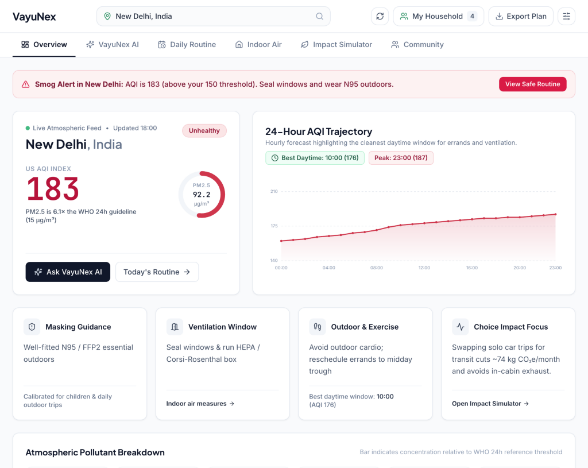

# VayuNex

**VayuNex** is a GenAI-powered urban air quality and clean-living intelligence platform designed to help families and communities navigate severe winter smog and urban air pollution. It combines real-time atmospheric telemetry with personalized daily routines, indoor air quality interventions, sustainable lifestyle alternatives, and quantified health and emission impact modeling.



---

## Core Capabilities

### 1. Real-Time Atmospheric Intelligence (`Overview`)
- **Global City Search & Telemetry**: Integrates with Open-Meteo Geocoding and Air Quality APIs (with automatic regional diurnal fallback) to display live `US AQI`, `PM2.5`, `PM10`, `NO₂`, `O₃`, `CO`, and `SO₂`.
- **24-Hour AQI Trajectory**: Interactive SVG forecast chart with dynamic Y-axis scaling and hover inspection, automatically identifying the cleanest daytime window for errands and cross-ventilation alongside peak inversion hours.
- **Immediate Action Matrix**: Personalized guidance for respiratory masking, window ventilation timing, outdoor activity, and household impact focus.

### 2. VayuNex GenAI Advisory (`VayuNex AI`)
- **Context-Aware Guidance**: Synchronizes every response with the active city's hourly smog curve and the user's household profile (family size, children, older adults, respiratory sensitivity, home type, HEPA availability, cooking fuel, and commute mode).
- **Quantified Impact Cards**: Attaches measurable outcomes (e.g., PM2.5 exposure reduction, daily CO₂e prevented, mask filtration efficiency) to recommendations.
- **Dual-Mode Engine**: Works out of the box using the built-in VayuNex Smart Engine and optionally connects to Google Gemini via user-configured settings (`x-goog-api-key` header).

### 3. Low-Emission Daily Routine Planner (`Daily Routine`)
- **Diurnal Schedule Generation**: Builds a 5-slot daily plan timed around morning traffic inversions, midday atmospheric mixing windows, and evening smog buildup.
- **Interactive Tracking**: Supports habit completion tracking, custom routine additions, and a live Daily Shield Score.

### 4. Indoor Air Quality Lab (`Indoor Air`)
- **Actionable Interventions**: Step-by-step protocols for DIY Corsi-Rosenthal MERV-13 box air cleaners, timed cross-ventilation, rear-burner + range-hood capture, wet-mopping, building envelope sealing, and zero-combustion indoor rules.
- **Room Filtration Sizing Calculator**: Computes target Clean Air Delivery Rate (CADR) in CFM for 5 air changes per hour based on room area and ceiling height.
- **Projected Indoor PM2.5**: Dynamically estimates indoor particulate reduction based on selected measures.

### 5. Sustainable Alternatives & Impact Simulator (`Impact Simulator`)
- **Choice Comparison**: Evaluates everyday habits against lower-emission alternatives across transport, cooking, heating, waste, and household care.
- **Direct Impact Quantification**: Calculates personal PM2.5 exposure avoided (`µg/m³·day`), equivalent passive smog-cigarettes avoided per week, monthly/annual CO₂e prevented, and a 50-household neighborhood multiplier.

### 6. Community Airshed Pledges & Action Plan Export (`Community`)
- **Neighborhood Initiatives**: Join or publish local clean-air pledges (no-idling school zones, smog-alert transit shifts, no-burn winter evenings) with collective CO₂e and PM2.5 metrics.
- **Action Plan Export**: Downloads a personalized `VayuNex-<City>-Action-Plan.txt` summary combining live AQI, routine slots, indoor measures, and sustainable swaps.

---

## Architecture

```
src/
├── App.tsx                         # Application shell, tab routing, alert banner, export
├── components/
│   ├── Header.tsx                  # City search with debounce & cancellation, profile/settings controls
│   ├── DashboardOverview.tsx       # AQI hero card, action grid, WHO-referenced pollutant breakdown
│   ├── AqiTrajectoryChart.tsx      # Memoized 24-hour SVG trajectory chart with hover tooltip
│   ├── AiAssistant.tsx             # Conversational advisor UI & impact card rendering
│   ├── RoutinePlanner.tsx          # Time-slotted routine checklist & custom habit creator
│   ├── IndoorAirLab.tsx            # Indoor air measures & Room CADR sizing calculator
│   ├── ImpactSimulator.tsx         # Sustainable swap simulator & quantified impact summary
│   ├── CommunityHub.tsx            # Neighborhood airshed pledges & creation form
│   ├── ProfileModal.tsx            # Household & lifestyle configurator
│   └── SettingsModal.tsx           # Alert threshold & optional Gemini API key configuration
├── data/
│   └── knowledgeBase.ts            # Curated preset cities, indoor measures, swaps, and pledges
├── hooks/
│   └── usePersistentState.ts       # Type-safe localStorage state synchronization hook
├── services/
│   ├── airQualityService.ts        # Open-Meteo Geocoding & Air Quality API client + EPA metadata
│   └── vayuAiEngine.ts             # Routine generator, clean-window detector, and GenAI engine
└── types/
    └── vayunex.ts                  # Strict TypeScript domain interfaces
```

---

## Technology Stack

- **Frontend**: React 19, TypeScript (strict mode), Tailwind CSS v4, Lucide Icons
- **Build Tooling**: Vite 6
- **Data Sources**: Open-Meteo Air Quality & Geocoding APIs, optional Google Gemini API
- **Testing**: Node.js built-in test runner (`node:test` + `node:assert/strict`)

---

## Getting Started

### Prerequisites
- Node.js 20+ and npm 10+

### Installation & Local Development

```bash
npm install
npm run dev
```

Open `http://localhost:5173/` in your browser.

### Verification Scripts

```bash
# Run unit tests (AQI categorization, clean-window detection, routine & AI engine)
npm test

# Type-check and build production bundle
npm run build
```

---

## Security & Accessibility

- **Security**: Strict input encoding (`encodeURIComponent`) and coordinate validation (`Number.isFinite`), optional API keys transmitted via `x-goog-api-key` headers rather than URL query strings, sanitized export filenames, and zero unsafe DOM sinks.
- **Accessibility**: Keyboard-navigable interactive cards (`role="checkbox"`, `Enter`/`Space` support), ARIA `tablist`/`tab` and `dialog` semantics, and descriptive `aria-label` attributes on icon controls and SVG visualizations.
